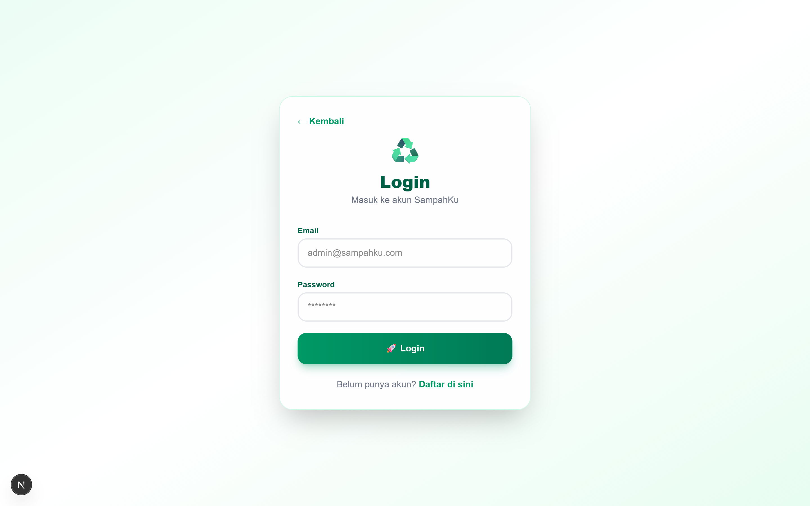
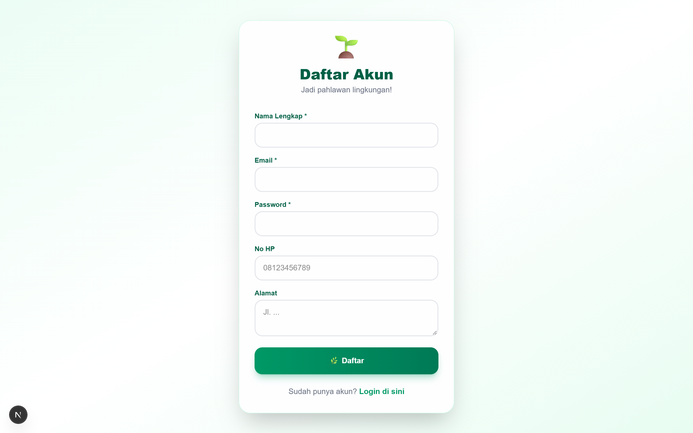
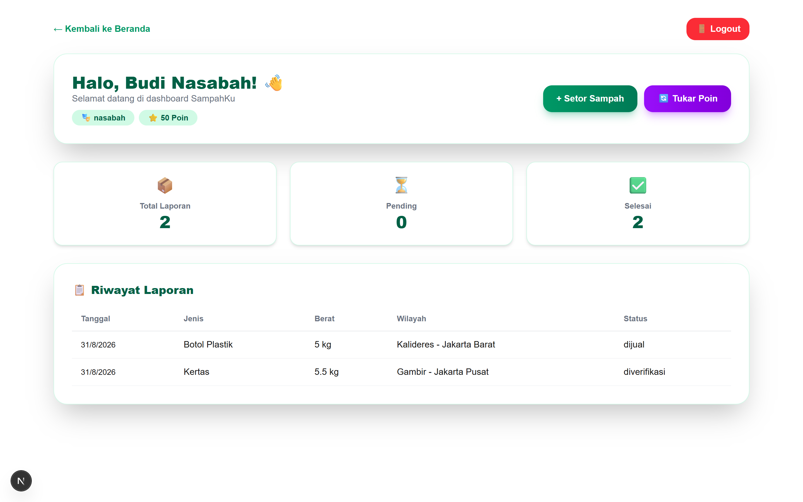
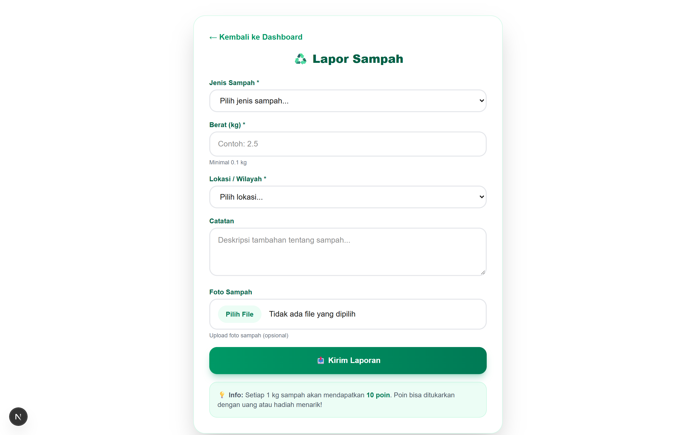
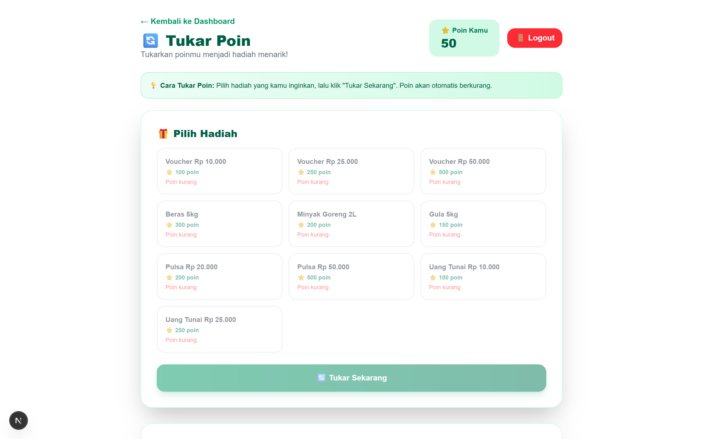
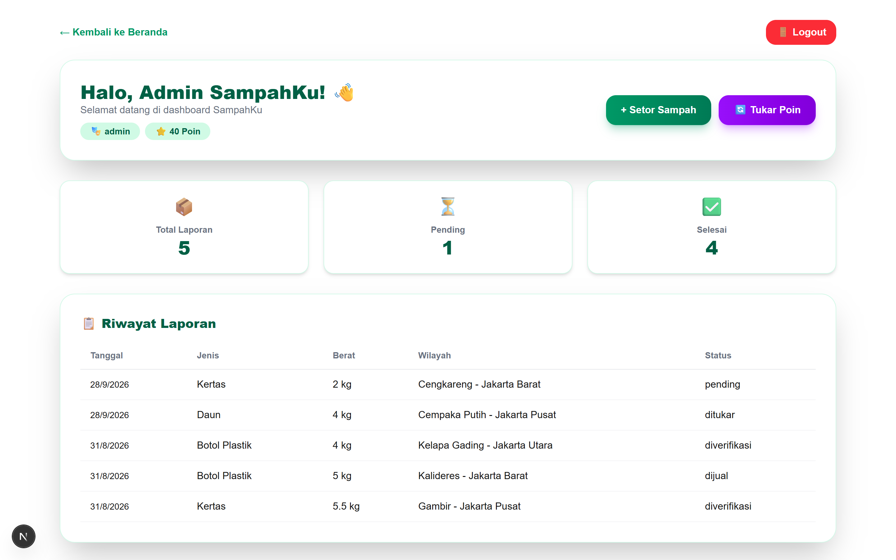
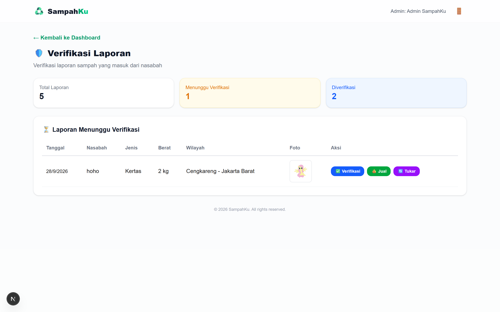
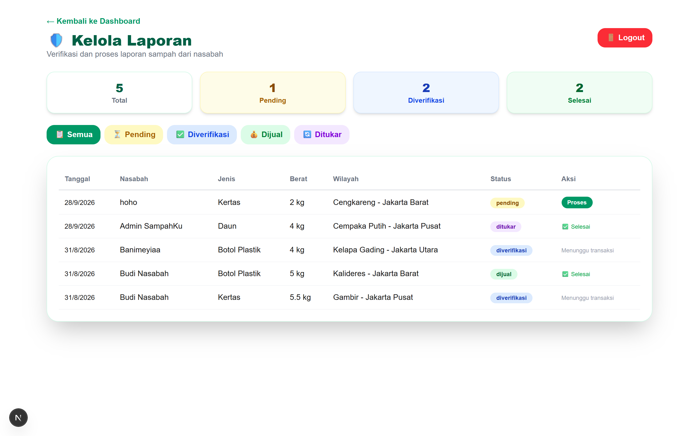
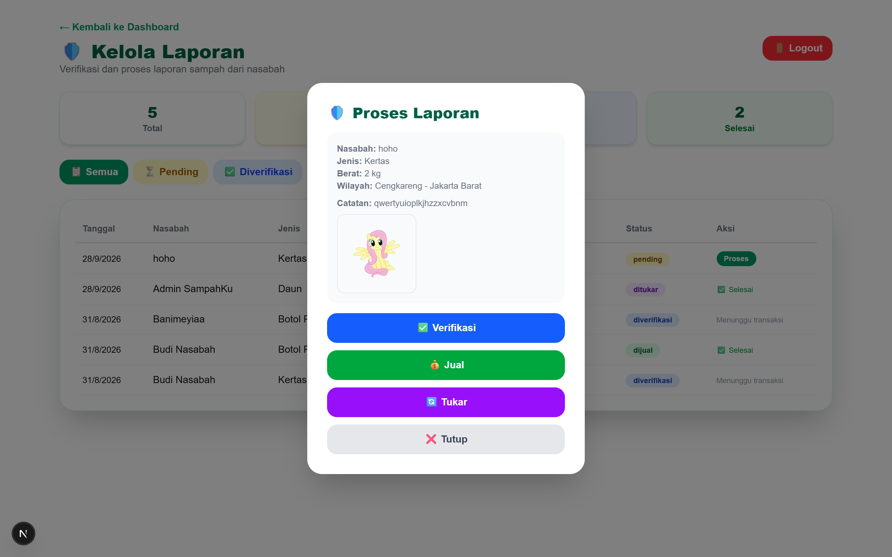

# ♻️ USER MANUAL & PANDUAN PENGGUNA PLATFORM SAMPAHKU

Selamat datang di **User Manual SampahKu** — Platform Digital Pengelolaan Sampah Terpadu Wilayah DKI Jakarta.

Dokumen ini disusun untuk memberikan panduan langkah demi langkah yang sangat detail dalam menggunakan seluruh fitur di platform **SampahKu**, lengkap dengan penjelasan tombol-tombol UI, alur kerja untuk **2 Peran (Role Nasabah & Role Admin)**, serta petunjuk penggunaan presentasi PowerPoint (.pptx).

---

## 📌 Daftar Isi
1. [Overview & Peran Pengguna (2 Roles)](#-overview--peran-pengguna-2-roles)
2. [Panduan Role 1: Nasabah (Masyarakat)](#-panduan-role-1-nasabah-masyarakat)
   - [Langkah 1: Pendaftaran (Registrasi) & Login](#langkah-1-pendaftaran-registrasi--login)
   - [Langkah 2: Memahami Dashboard Nasabah](#langkah-2-memahami-dashboard-nasabah)
   - [Langkah 3: Cara Menyetor / Melaporkan Sampah](#langkah-3-cara-menyetor--melaporkan-sampah)
   - [Langkah 4: Cara Menukarkan Poin Hadiah](#langkah-4-cara-menukarkan-poin-hadiah)
   - [Panduan Detail Tombol & Elemen UI (Nasabah)](#panduan-detail-tombol--elemen-ui-nasabah)
3. [Panduan Role 2: Admin (Pengelola)](#-panduan-role-2-admin-pengelola)
   - [Langkah 1: Login Admin & Navigation Panel](#langkah-1-login-admin--navigation-panel)
   - [Langkah 2: Verifikasi Laporan Sampah Masuk](#langkah-2-verifikasi-laporan-sampah-masuk)
   - [Langkah 3: Memproses & Mengelola Database Laporan](#langkah-3-memproses--mengelola-database-laporan)
   - [Panduan Detail Tombol & Elemen UI (Admin)](#panduan-detail-tombol--elemen-ui-admin)
4. [Kredensial Akun Pengujian (Testing)](#-kredensial-akun-pengujian-testing)
5. [File Presentasi PowerPoint (User_Manual_SampahKu.pptx)](#-file-presentasi-powerpoint-user_manual_sampahkupptx)

---

## 🌐 Overview & Peran Pengguna (2 Roles)

Platform **SampahKu** dirancang untuk memudahkan warga Jakarta dalam mengelola sampah secara digital, mengubah limbah menjadi nilai ekonomis (poin/uang), serta membantu pengelola memantau alur penyetoran sampah secara real-time.

Sistem ini mendukung **2 Peran (Roles)** utama:
1. **Nasabah (User)**: Warga / penyetor sampah yang mendaftar, melaporkan jenis & berat sampah, serta mengumpulkan & menukarkan poin hadiah.
2. **Admin (Administrator)**: Pengelola sistem yang bertugas memverifikasi keabsahan laporan sampah, mengubah status transaksi (Diverifikasi, Dijual, Ditukar), dan memantau seluruh statistik wilayah.

---

## 👤 Panduan Role 1: Nasabah (Masyarakat)

### Langkah 1: Pendaftaran (Registrasi) & Login

1. **Akses Beranda**: Buka aplikasi di browser (misal `http://localhost:3000`).
2. **Pendaftaran Akun (Register)**:
   - Klik tombol **🌱 Daftar** di header atau beranda.
   - Isi form pendaftaran dengan data:
     - **Nama Lengkap**: Nama sesuai KTP/identitas.
     - **Email**: Alamat email aktif.
     - **Password**: Kata sandi akun.
     - **Nomor HP**: Nomor telepon yang dapat dihubungi.
     - **Alamat**: Alamat domisili penyetoran di Jakarta.
   - Klik tombol **🌱 Daftar Sekarang**.
3. **Login Akun**:
   - Jika sudah memiliki akun, klik tombol **🔑 Login**.
   - Masukkan Email dan Password, lalu klik **🔑 Login**.

*Gambar 1: Form Login Nasabah*

*Gambar 2: Form Pendaftaran Akun Nasabah*

---

### Langkah 2: Memahami Dashboard Nasabah

Setelah berhasil login, anda akan diarahkan ke **Dashboard Nasabah**:

*Gambar 3: Tampilan Dashboard Nasabah*

**Elemen & Fitur Utama Dashboard Nasabah**:
- **⭐ Badge Poin**: Menampilkan total perolehan poin aktif anda. (Setiap 1 kg sampah disetor = **10 Poin**).
- **Kartu Ringkasan Statistik**:
  - 📦 **Total Laporan**: Jumlah keseluruhan penyetoran yang pernah anda kirim.
  - ⏳ **Pending**: Laporan yang sedang menunggu proses verifikasi admin.
  - ✅ **Selesai**: Laporan yang telah diverifikasi dan diproses oleh admin.
- **Tabel Riwayat Laporan**: Daftar transaksi terkini lengkap dengan tanggal, jenis sampah, berat (kg), lokasi wilayah Jakarta, dan status.
- **Navigasi Cepat**: Tombol **+ Setor Sampah** dan **🔄 Tukar Poin**.

---

### Langkah 3: Cara Menyetor / Melaporkan Sampah

1. Pada Dashboard, klik tombol **+ Setor Sampah** (atau akses link `/laporan/tambah`).
2. Isi formulir penyetoran sampah secara lengkap:
   - **Jenis Sampah**: Pilih jenis sampah (*Plastik, Kertas, Logam, Botol Plastik, Organik, Daun, dll*). Price per kg otomatis ditampilkan di dropdown.
   - **Berat (kg)**: Masukkan estimasi berat sampah (minimal 0.1 kg).
   - **Lokasi / Wilayah**: Pilih kecamatan wilayah Jakarta tempat penyetoran.
   - **Catatan**: Berikan deskripsi atau keterangan tambahan kondisi sampah (opsional).
   - **Foto Sampah**: Unggah foto bukti fisik sampah.
3. Klik **📤 Kirim Laporan**. Status laporan akan tercatat sebagai **Pending** hingga diverifikasi oleh admin.

*Gambar 4: Tampilan Form Setor Sampah*

---

### Langkah 4: Cara Menukarkan Poin Hadiah

1. Pada Dashboard, klik tombol **🔄 Tukar Poin** (atau akses `/tukar-poin`).
2. Cek jumlah poin anda di bagian kanan atas halaman.
3. Pilih **Katalog Hadiah** yang diinginkan:
   - Voucher Belanja Rp 10.000 (100 Poin)
   - Voucher Belanja Rp 25.000 (250 Poin)
   - Voucher Belanja Rp 50.000 (500 Poin)
   - Beras Super 5kg (300 Poin)
   - Minyak Goreng 2L (200 Poin)
   - Pulsa / Saldo E-Wallet & Uang Tunai
4. Klik card hadiah pilihan anda, lalu tekan **🔄 Tukar Sekarang**.
5. Saldo poin anda otomatis berkurang dan transaksi penukaran langsung tercatat di **Tabel Riwayat Penukaran**.

*Gambar 5: Tampilan Halaman Tukar Poin Hadiah*

---

### 🔘 Panduan Detail Tombol & Elemen UI (Nasabah)

| Tombol / Elemen UI | Lokasi | Fungsi & Cara Kerja |
| :--- | :--- | :--- |
| **🌱 Daftar** | Navigation Bar & Landing Page | Membuka form pendaftaran akun baru untuk nasabah. |
| **🔑 Login** | Navigation Bar & Form Auth | Mengotentikasi email dan password nasabah ke dalam sistem. |
| **🚀 Dashboard** | Navigation Bar | Mengembalikan posisi tampilan ke halaman ringkasan statistik nasabah. |
| **➕ + Setor Sampah** | Dashboard Utama (Teks Hijau) | Mengarahkan ke form input laporan penyetoran sampah baru. |
| **📤 Kirim Laporan** | Form `/laporan/tambah` | Menyimpan data laporan ke database dengan status `pending`. |
| **🔄 Tukar Poin** | Dashboard Utama & Top Nav | Mengarahkan ke katalog penukaran poin hadiah dan sembako. |
| **🔄 Tukar Sekarang** | Card Hadiah Katalog | Mengonfirmasi transaksi penukaran poin nasabah ke hadiah terpilih. |
| **🚪 Logout** | Header Kanan Atas | Mengakhiri sesi login pengguna dan menghapus token JWT dari browser. |

---

## 🛡️ Panduan Role 2: Admin (Pengelola)

### Langkah 1: Login Admin & Navigation Panel

1. Masuk menggunakan akun Administrator (`admin@sampahku.com` / `admin123`).
2. Setelah login, sistem secara otomatis mengenali peran anda sebagai **Admin**.
3. Banner **🛡️ Panel Admin** berwarna hijau tua akan muncul di bagian bawah Dashboard dengan menu navigasi cepat:
   - **✅ Verifikasi Laporan**
   - **📋 Semua Laporan**

*Gambar 6: Tampilan Dashboard dengan Panel Admin*

---

### Langkah 2: Verifikasi Laporan Sampah Masuk

1. Klik menu **✅ Verifikasi Laporan** (atau akses `/admin/verifikasi`).
2. Halaman ini khusus menyajikan daftar laporan nasabah yang masih berstatus **Pending**.
3. Admin dapat memeriksa:
   - Tanggal & Nama Nasabah Penyetor
   - Jenis & Berat Sampah (kg)
   - Foto Bukti Fisik Sampah
4. Admin dapat menekan salah satu dari **3 Tombol Aksi Cepat**:
   - **✅ Verifikasi**: Menyetujui keabsahan laporan sampah.
   - **💰 Jual**: Memproses sampah untuk transaksi penjualan langsung.
   - **🔄 Tukar**: Mengonversi hasil sampah menjadi poin nasabah.

*Gambar 7: Halaman Verifikasi Laporan oleh Admin*

---

### Langkah 3: Memproses & Mengelola Database Laporan

1. Klik menu **📋 Kelola Laporan** (atau akses `/admin/laporan`).
2. Halaman ini memuat seluruh data laporan dari semua nasabah di wilayah DKI Jakarta.
3. **Filter Status**: Klik tombol filter untuk menyaring tampilan laporan (**Semua, Pending, Diverifikasi, Dijual, Ditukar**).
4. **Modal Dialog Detail**:
   - Pada baris laporan berstatus pending, klik tombol **Proses**.
   - Pop-up modal dialog akan terbuka menampilkan detail nasabah, foto resolusi tinggi, catatan khusus, dan tombol opsi eksekusi status.

*Gambar 8: Tampilan Tabel Kelola Laporan Admin*

*Gambar 9: Tampilan Pop-up Modal Dialog Proses Laporan*

---

### 🔘 Panduan Detail Tombol & Elemen UI (Admin)

| Tombol / Elemen UI | Lokasi | Fungsi & Cara Kerja |
| :--- | :--- | :--- |
| **🛡️ Banner Panel Admin** | Bagian Bawah Dashboard | Navigasi khusus pengelola untuk berpindah ke fitur verifikasi dan kelola database. |
| **✅ Verifikasi Laporan** | Panel Admin & Navbar | Membuka antrean laporan penyetoran sampah baru yang butuh verifikasi. |
| **📋 Kelola Laporan** | Panel Admin & Navbar | Membuka database lengkap seluruh laporan sampah se-Jakarta. |
| **✅ Verifikasi (Aksi)** | Tabel Verifikasi & Modal | Menyetujui laporan tanpa mengubahnya menjadi transaksi penjualan/poin. |
| **💰 Jual (Aksi)** | Tabel Verifikasi & Modal | Mengubah status laporan menjadi `dijual` ke pihak pengepul/daur ulang. |
| **🔄 Tukar (Aksi)** | Tabel Verifikasi & Modal | Mengubah status menjadi `ditukar` dan otomatis menambahkan poin ke akun nasabah. |
| **🔍 Tombol Filter Status** | Halaman Kelola Laporan | Menyaring baris tabel laporan berdasarkan kategori status tertentu. |
| **⚡ Tombol Proses / Detail** | Baris Tabel Laporan Pending | Membuka pop-up modal dialog untuk peninjauan foto resolusi tinggi & eksekusi status. |

---

## 🔑 Kredensial Akun Pengujian (Testing)

Gunakan akun berikut untuk menguji kedua role pada aplikasi web:

| Role | Email | Password | Hak Akses & Fitur |
| :--- | :--- | :--- | :--- |
| **Nasabah** | `budi@email.com` | `nasabah123` | Dashboard Nasabah, Setor Sampah, Tukar Poin Hadiah, Riwayat Transaksi |
| **Admin** | `admin@sampahku.com` | `admin123` | Banner Panel Admin, Verifikasi Laporan, Kelola Database, Filter & Action Buttons |

---

## 📊 File Presentasi PowerPoint (User_Manual_SampahKu.pptx)

File presentation PowerPoint **16:9 Widescreen** telah dibuat dan ditempatkan di root folder web project:

📁 **Lokasi File PPTX**:
`c:\Users\farra\sampah-farras\User_Manual_SampahKu.pptx`

**Detail Styling & Konten PPTX**:
- **Design Header & Style Visual**: Mengadopsi visual style referensi (`SALFORD & CO.` design style) dengan garis horizontal dan ornamen bintang 4 sudut (`✦`).
- **Skema Warna Khas SampahKu**: Menggunakan paduan **Emerald Green** (`#043927`, `#064E3B`, `#059669`), **Mint Accent** (`#A7F3D0`), **Gold Accent** (`#F59E0B`), dan **Slate Dark Text** (`#111827`).
- **15 Slide Komprehensif**:
  1. Slide Cover Utama (`SAMPAHKU DIGITAL PLATFORM` style)
  2. Overview System & 2 Roles
  3. Cover Bagian 1: Panduan Role Nasabah
  4. Nasabah Step 1: Registrasi & Login (Screenshot login & register)
  5. Nasabah Step 2: Dashboard & Total Poin (Screenshot dashboard)
  6. Nasabah Step 3: Cara Setor Sampah (Screenshot form lapor)
  7. Nasabah Step 4: Cara Tukar Poin Hadiah (Screenshot katalog)
  8. Nasabah: Detail Penjelasan Tombol & UI (Tabel/Card grid tombol)
  9. Cover Bagian 2: Panduan Role Admin
  10. Admin Step 1: Dashboard Admin & Navigation (Screenshot admin dashboard)
  11. Admin Step 2: Halaman Verifikasi Laporan (Screenshot verifikasi)
  12. Admin Step 3: Kelola Database & Modal Dialog (Screenshot kelola & modal)
  13. Admin: Detail Penjelasan Tombol & UI (Tabel/Card grid tombol admin)
  14. Kredensial Testing & Matriks Perbandingan Hak Akses 2 Roles
  15. Closing Slide (Terima Kasih & Jakarta Clean & Green)

---
*Dokumen ini dibuat otomatis sebagai panduan resmi penggunaan Platform SampahKu.*
